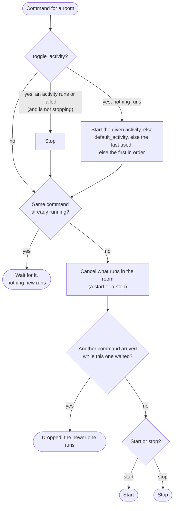
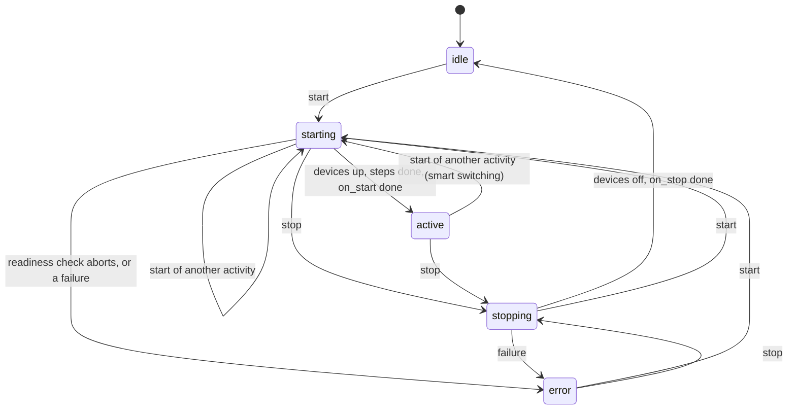
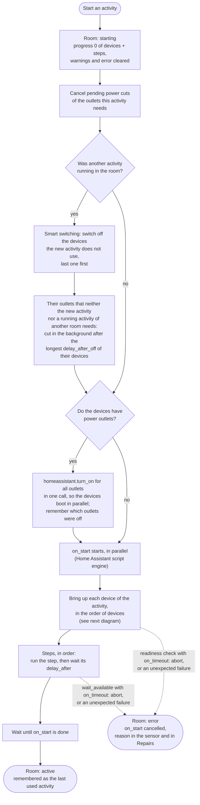
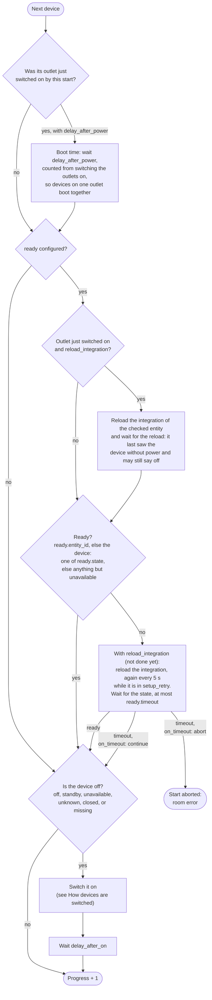
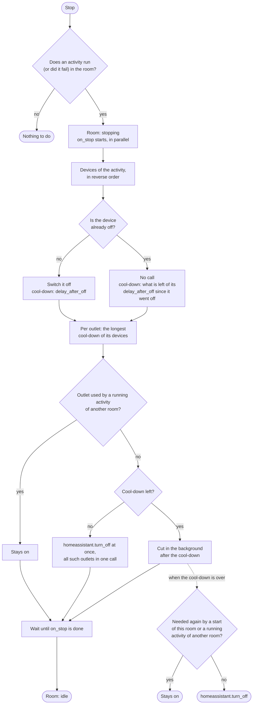
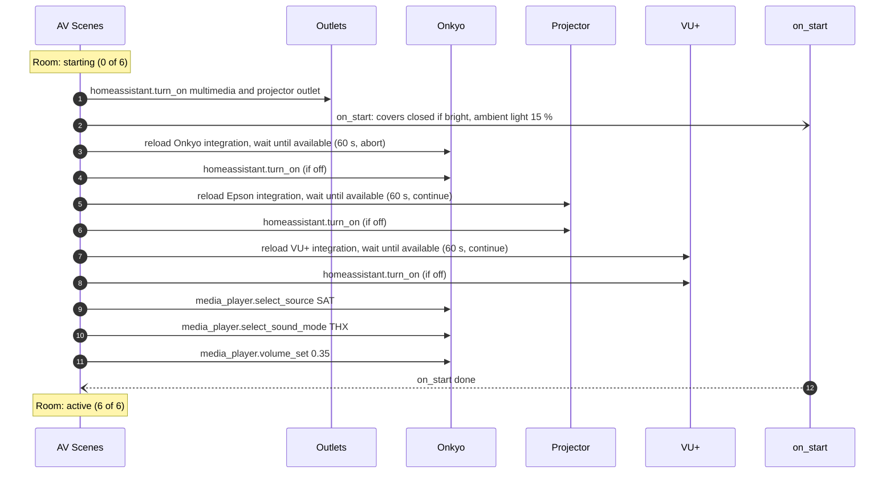
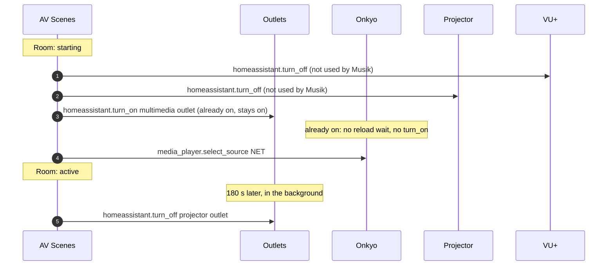
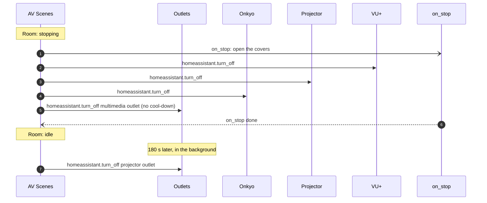

# Activity Flow

What AV Scenes switches when, and how. The diagrams follow the engine in `coordinator.py`; the configuration keys are described in the [README](README.md#configuration).

- [Commands](#commands) – what happens when a start or stop arrives
- [Room states](#room-states) – idle, starting, active, stopping, error
- [Start](#start) – smart switching, power, devices, steps, `on_start`
- [Bringing up a device](#bringing-up-a-device) – boot time, readiness check, switching on
- [Stop](#stop) – devices off, cool-down, power outlets, `on_stop`
- [How devices are switched](#how-devices-are-switched) – which action for which entity
- [Example](#example) – the living room from the README, step by step

## Commands

Every way to start or stop an activity ends up here: the scene, the room's switch and select, the card, and the actions `start_activity`, `stop_activity` and `toggle_activity`. Commands for one room run one at a time; the last one wins.

A cancelled start or stop ends where it is: nothing is undone, its `on_start` or `on_stop` actions are cancelled, and the new command takes over from that state. A stop after a cancelled or failed start switches off what was already powered.

## Room states

The state is the room's sensor; the switch is on in every state but `idle`.

After a Home Assistant restart, `active` and `error` are restored; a room that was `starting` or `stopping` comes back as `error` ("Interrupted by a Home Assistant restart"), so a stop cleans up.

## Start

Steps run once all devices are up:

| Step | Action |
|------|--------|
| `set_source` | `media_player.select_source` |
| `set_volume` | `media_player.volume_set` |
| `set_sound_mode` | `media_player.select_sound_mode` |
| `set_brightness`, `set_color_temp` | `light.turn_on` |
| `set_position`, `set_tilt` | `cover.set_cover_position`, `cover.set_cover_tilt_position` |
| `power_on`, `power_off` | as in [How devices are switched](#how-devices-are-switched) |
| `call_action` | the given action with its `data` and `target` |
| `wait_available` | a readiness check at this point, see below |
| `delay` | nothing, only its `delay_after` |

A step that fails or takes longer than 15 seconds is listed in the sensor's `warnings`; the start goes on.

## Bringing up a device

For every device of the activity, in the order of `devices`:

A `wait_available` step runs the same check as `ready`, at any point of the steps, for a device or any entity.

## Stop

The room does not wait for the cool-down: it is `idle` as soon as its devices are off and `on_stop` is done, so the status LED of a wall button goes out at once. `on_stop` runs on a full stop only, not when smart switching to another activity.

## How devices are switched

| Device | Switch on | Switch off |
|--------|-----------|------------|
| Power outlet (`power_switch`) | `homeassistant.turn_on`, all outlets of the activity in one call | `homeassistant.turn_off` |
| Cover | `cover.open_cover` | `cover.close_cover` |
| Media player that cannot be switched (no turn on / turn off support, e.g. a Sonos speaker) | skipped | skipped |
| Device its integration reports as unreachable | skipped, with a warning | `homeassistant.turn_off` |
| Any other entity | `homeassistant.turn_on` | `homeassistant.turn_off` |

Every call waits for the device (`blocking`), at most 15 seconds. A call that fails or takes longer is logged and listed in the sensor's `warnings`; the activity goes on. A device that is already on gets no turn-on and no `delay_after_on`.

## Example

The living room from the [README](README.md#configuration): Onkyo receiver and VU+ on the multimedia outlet, the projector on its own outlet with 180 s cool-down, every device with a readiness check that reloads its integration.

### Starting TV from idle

If the Onkyo does not become available within 60 s, the start ends in `error` after step 3; with `continue` (projector, VU+) it only logs a warning and goes on.

### Switching from TV to Musik

`on_stop` of TV does not run, the covers stay as they are.

### Stopping TV

